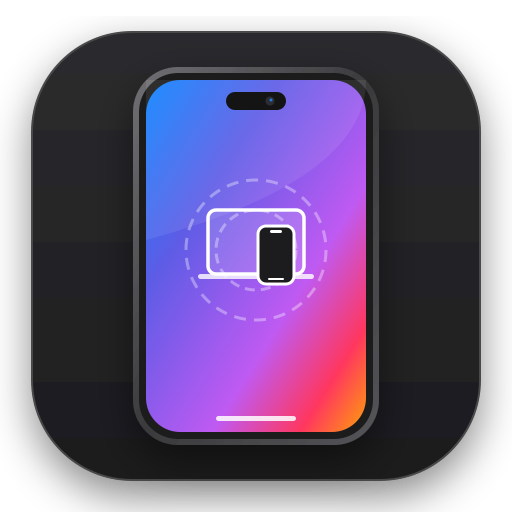

# Phone Mirroring (`kphonemirroring`)

**macOS Sequoia iPhone Mirroring experience for Android on KDE Plasma 6 (Wayland / Qt6).**

Designed to deliver the seamless continuity experience of macOS 15 Sequoia Phone Mirroring on Linux desktops with zero friction.



---

## ✨ Features

- **macOS Sequoia Phone Mirroring UI**: Frosted acrylic dark glass window, smartphone chassis preview with titanium bezels and punch-hole camera.
- **Sequoia Floating Toolbar**:
  - 🏠 **Home**: Simulates home swipe / button.
  - 🗂️ **App Switcher**: Recent apps and multitasking.
  - 🔒 **Lock**: Powers off or locks the device screen.
  - 🔔 **Notifications**: Quick pull-down of Android notification shade.
  - ⚙️ **Quick Settings**: Instant access to toggles.
  - 📸 **Quick Screenshot**: One-click direct screenshot saved directly to `~/Imágenes`.
  - 🔊 / 🔉 **Volume Controls**: Real-time volume adjustments.
- **Dual Connection Mode**:
  - **USB Mode**: Ultra-low latency, 60 FPS, battery charging.
  - **Wi-Fi Mode**: 100% wireless mirroring without cables via ADB TCP/IP.
- **Privacy & Power Saver**:
  - Keeps the physical phone screen turned off while interacting on the desktop (`--turn-screen-off`).
  - Keeps the phone awake while connected (`--stay-awake`).
- **High-Fidelity Audio**:
  - Real-time stereo audio routed through PipeWire / PulseAudio into your PC speakers or headphones.
- **Xiaomi HyperOS & Android Integration**:
  - Native detection of device model, Android release, battery level, charging status, and local Wi-Fi IP address.

---

## 🚀 Requisitos

- **KDE Plasma 6** (Wayland)
- **Qt 6** (Core, Gui, Qml, Quick, QuickControls2)
- **scrcpy** (v2.0+)
- **android-tools** (`adb`)
- **android-udev**

---

## 🛠️ Compilación e Instalación

```bash
git clone https://github.com/cesarconte/kphonemirroring.git
cd kphonemirroring
cmake -B build -DCMAKE_BUILD_TYPE=Release
cmake --build build
ctest --test-dir build --output-on-failure
sudo cmake --install build
```

---

## 📄 Licencia

GPLv3. Desarrollado por César Conte.
